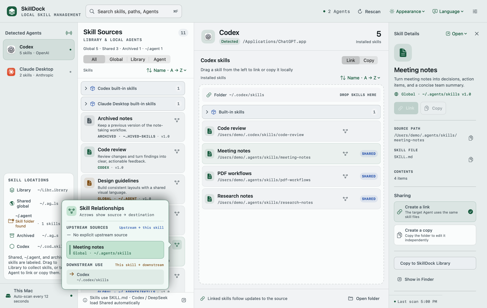

# SkillDock

[English](README.md)

SkillDock 是原生 macOS Agent 技能管理器。自动发现 Codex、Claude Desktop 和 DeepSeek Harness，把技能集中到 Library，再通过拖动分配给需要它们的 Agent。



## 功能

- **拖动分享**：让多个 Agent 链接同一份技能，或创建可以独立编辑的副本。
- **查看关系**：悬浮在技能卡片的关系按钮上，用箭头查看技能来源和下游 Agent。
- **搜索与排序**：搜索名称、说明、别名和路径，按名称、来源或最近修改排序。自带默认技能初始收起。
- **整理技能**：收纳到 Library，在详情栏归档或删除。
- **打开工具**：通过卡片或详情栏，在终端、VS Code、Codex 或 Claude Desktop 中打开技能目录。
- **切换外观与语言**：支持浅色、深色、跟随系统，以及简体中文和英语。

## 构建与启动

需要 Apple Silicon、macOS 14 或更新版本，以及 Xcode 15 或更新版本的命令行工具：

```sh
xcode-select --install
```

```sh
git clone https://github.com/wany26/SkillDock.git
cd SkillDock
./scripts/build-macos-app.sh
open "$HOME/Desktop/SkillDock.app"
```

指定其他安装位置：

```sh
./scripts/build-macos-app.sh /Applications/SkillDock.app
```

## 使用

1. 在侧栏选择 Agent，查看它的技能。
2. 把技能拖到 Agent 或其技能列表。选择「创建链接」共享技能文件，或「复制独立副本」单独编辑。
3. 把技能拖到「Library」集中收纳，再选择性分配给 Agent。把可归档的技能拖到「归档」即可归档。
4. 选择技能查看详情和管理操作。点击「打开」，或右键卡片，选择打开它的应用。

按 **⌘F** 搜索，按 **Esc** 清空搜索。列表上的排序菜单和顶部的「外观」「语言」菜单用于切换视图；排序、外观和语言选择会被保存。

## 技能目录

SkillDock 从包含 `SKILL.md` 的文件夹中发现技能。

| 目录 | 用途 |
| --- | --- |
| `~/Library/Application Support/SkillDock/Library` | 集中收纳并选择性分配给 Agent |
| `~/.agents/skills` | Codex 和 DeepSeek Harness 自动读取的共享技能 |
| `~/.agent` 和 `~/.agent/skills` | 其他全局来源 |
| `~/.agents/archived-skills` | 已归档技能 |
| `~/.codex/skills` | Codex 技能 |
| `~/.claude/skills` | Claude Desktop 本地技能，包含 `synced` 子目录 |
| `~/.dsh/skills` | DeepSeek Harness 技能；配置 `DSH_HOME` 时使用 `$DSH_HOME/skills` |

## 开发

| 文件 | 用途 |
| --- | --- |
| `native/SkillDockApp.swift` | SwiftUI 界面、发现和管理技能 |
| `native/SkillOpenService.swift` | 原生应用打开操作 |
| `scripts/build-macos-app.sh` | 构建和签名应用包 |
| `scripts/generate-app-icon.swift` | 生成应用图标 |

重新生成图标资源：

```sh
swift scripts/generate-app-icon.swift native/Resources
```

## 许可

[MIT](LICENSE)
